# WFMC 新手指引 · 从零到进游戏

> 给**完全没接触过 Minecraft 模组**的人看。全程只用鼠标，不需要命令行、不需要懂 Java。
> 下面出现的按钮名和界面上的字**一模一样**，都用「」括起来，照着点就行。
> 每一步都写了**「做对了会怎样」**——看不见那个结果，就说明这一步没成，别往下走，回来重看一遍。
> 截图都是软件里实拍的（v1.0.44），图在 `docs/images/`。

---

## 0. 先记住三句话（后面所有问题都是这三句没对）

| 词 | 一句话 |
|---|---|
| **实例**（Instance） | 一个实例 = 一套独立的游戏环境，就是一个装好的游戏文件夹。模组、光影、存档都各归各的。你可以同时有"纯净服"和"机械动力包"两个实例，互不干扰。 |
| **版本**（Version） | 一个实例里可以装**好几个**版本，比如 `1.20.1`（纯净）和 `fabric-loader-0.18.2-1.20.1`（带模组）。同一时刻**只有一个**「启动用」，点「启动游戏」进的就是它。 |
| **加载器**（Fabric / NeoForge / Forge） | 让模组生效的那层"插件底座"。**只有带加载器的版本才会读取 mods 文件夹里的模组**；进纯净版当然一个模组都没有。 |

> 记住这三句，80% 的"我明明装了模组却没生效"能自己解决，见第 4 章。

---

## 1. 第一次打开（一次性，1 分钟）

第一次启动会问你三件事，答完就进主界面：

1. **数据放哪** —— 选一个剩余空间充足的盘（一个带模组的实例通常 1.5–3 GB）。**不要**放进安装目录，也不建议放 C 盘系统目录。
   - 做对了会怎样：点「完成，开始用」后进到「首页」，左下角显示你选的数据目录。
   - 以后想换：设置 →「数据目录」→「换成其它目录」。搬家时它只**复制**不删旧目录，你确认新位置没问题后再自己删旧的。
2. **内存给多少** —— 4 GB 内存的机器给 2 GB，8 GB 给 4 GB，16 GB 给 6–8 GB。以后每个实例可以单独改。
3. **起个游戏名** —— 英文/数字/下划线，这是你的离线账号名，单机直接能玩（正版登录见第 10 章）。

> 想中途退出引导：右上角「跳过」。
> 答完这三件事，软件还会自己放一遍**高亮新手引导**（15 步，指着界面上该点的地方讲）。看完点「下一步」，随时按 Esc 或「跳过」退出；以后想重看，点左边侧边栏最上面的「新手引导」。
> 界面目前是**部分汉化**：导航、标题、主要按钮都是中文，少数说明文字和描述还是英文，这是正常的。

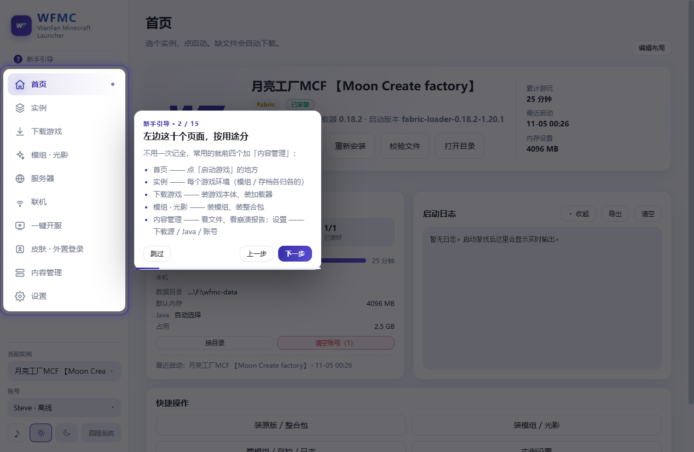

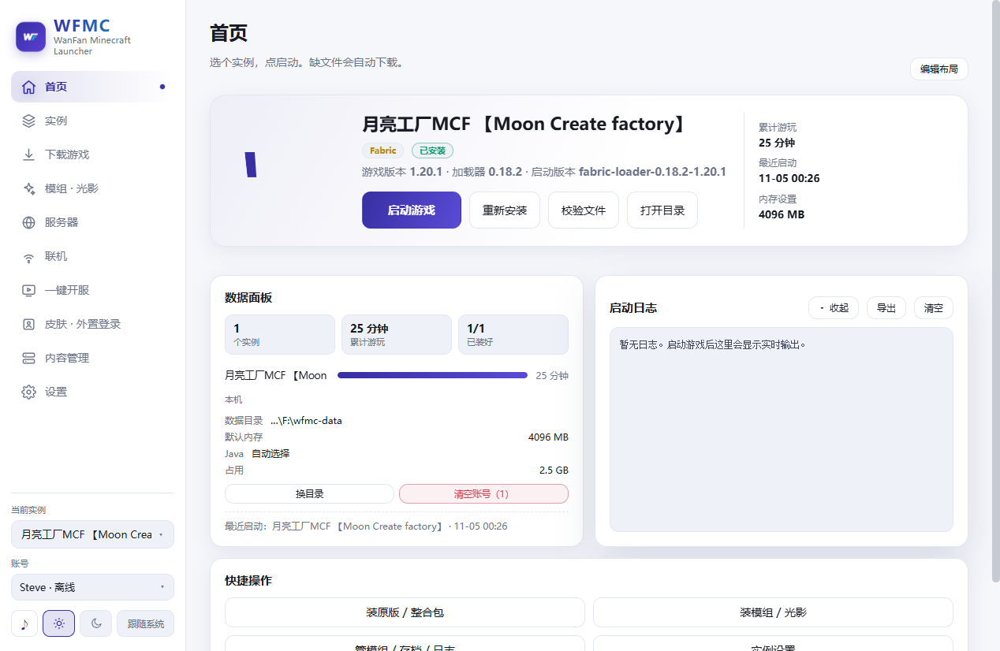

---

## 2. 下载游戏本体（第一次必做）

左边点「下载游戏」。

1. 「下载源」选 **国内镜像 BMCLAPI（推荐）**（在国外或镜像抽风时改 `Mojang 官方`）。
2. 「Minecraft 版本」选一个常用版本，比如 `1.20.1`。
3. 「加载器」：**纯净游戏就留`原版`**；想加模组，这里也能直接选 `Fabric（推荐，轻量）` / `NeoForge` / `Forge`（第一次用建议走第 3 章的整合包，会一步装好）。
4. 点「下载并安装」。

**做对了会怎样**
- 出现进度条，按真实字节走，能看到已下载 MB 数、速度和剩余时间。
- 第一次是几百 MB（1.20+ 一般 300 MB 左右，带完整资源文件会更多），网络慢要十几分钟。**下载期间别关窗口。**
- 装完自动跳到「实例」页，里面多了一个实例卡片。

> 下载中途断了不用重来：下载器支持多线程 + 断点续传，再点一次会接着下。
> 装完回到「首页」，卡片上点「启动游戏」就能进游戏了。

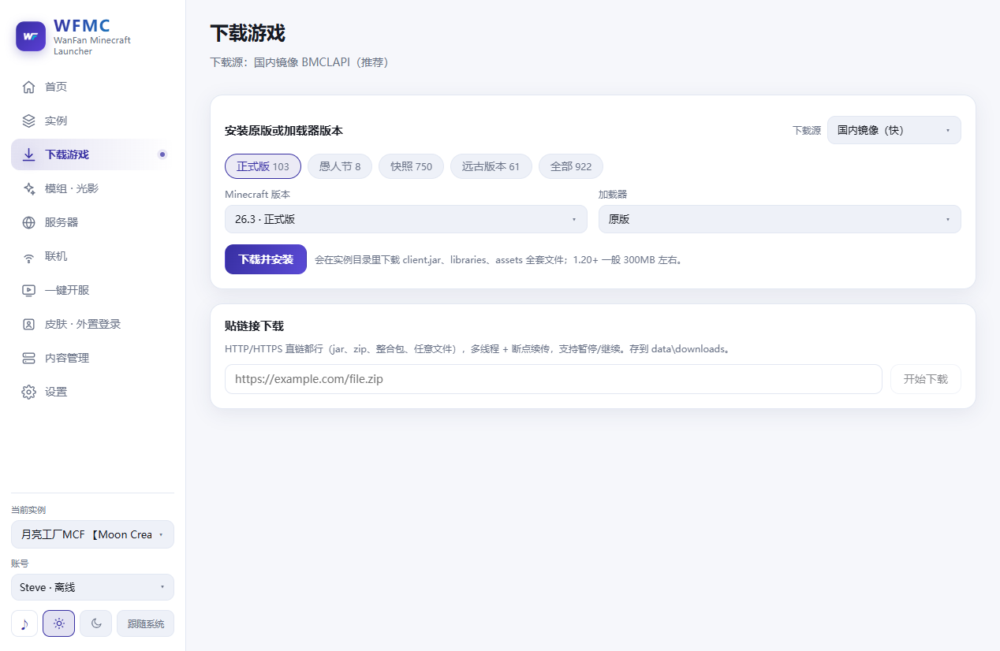

---

## 3. 装整合包（新手最省事的一条路）

整合包 = 别人配好的一整套模组 + 配置，装完直接玩。三种来源：

### 3.1 在线搜（Modrinth，免 API Key）

左边「模组 · 光影」→ 顶部切到 **「整合包」** 分栏。

1. 搜索框里输关键词（例：`机械动力`、`空岛`、`RLCraft`），点「搜索」。
2. 找到想要的，点「安装最新版」；想装特定版本就点「选版本」，再点那一行的「装这个」。
3. 想先看看介绍：点「Modrinth 页面」。

> 搜不到就换个**英文名**再搜一次；中文名匹配不全很常见。
> 别人给你一个 `.mrpack` 或 CurseForge 压缩包：点「导入本地 .mrpack / .zip」选文件即可。
> 别人给你一个已装好的实例压缩包（`.zip`）：去「实例」页 →右上「导入实例包」。

### 3.2 装的时候会发生什么

- 装之前会先弹依赖清单：**主文件 + 必需前置（一起装，取消不了）+ 可选前置（你勾）+ 会冲突的（只提示，不安装）**。确认后才开始。
- 装的过程在**右下角任务面板**跑，你可以继续刷别的页面。
- 装完会**新建一个实例**，自动下好对应版本的 Minecraft 和加载器。

### 3.3 判据（一定要看这一步）

**做对了会怎样**
- 实例列表里多出一个新卡片，上面有 `Fabric` 或 `NeoForge` 徽标和「已安装」。
- 进「实例」→ 卡片上「概览」→「已装版本」列表里，**带加载器的那一行（`fabric-loader-…`）左边有蓝色「启动用」标记**。

**没做到？** 那你进游戏还是原版。这是最常见的坑，直接看第 4 章。

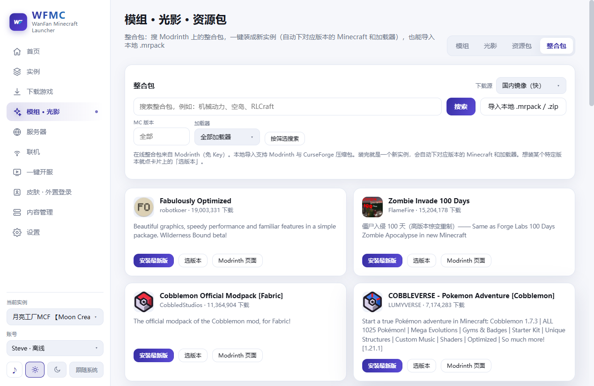

---

## 4. 装了模组却进的是原版：改「启动用」

### 4.1 症状

- mods 文件夹里 100 多个 jar 都在，加载器也装了；
- 进游戏后物品、方块全是原版内容，一个整合包的东西都没有；
- 「首页」→「启动日志」里没有加载模组的输出（只有原版资源加载）。

### 4.2 原因

一个实例里可能同时装着 `1.20.1`（纯净）和 `fabric-loader-0.18.2-1.20.1`（带模组）**两个版本**。点「启动游戏」只认那个标着「启动用」的版本——如果标记落在纯净版上，你就是在玩纯净版。

### 4.3 修法（10 秒）

1. 左边「实例」→ 点你这个整合包实例的卡片。
2. 切到 **「概览」**，找到「已装版本」列表。
3. 找到 `fabric-loader-…`（或 `neoforge-…` / `forge-…`）那一行，点它右边的 **「用这个启动」**。
4. 看到蓝色 **「启动用」** 标记从 `1.20.1` 那行跳到加载器那行，就对了。
5. 回「首页」，「启动游戏」。

**做对了会怎样**
- 「首页」卡片上那行小字变成 `… · 启动版本 fabric-loader-0.18.2-1.20.1`（不再是 `1.20.1`）。
- 进游戏后，主菜单界面会显示加载器名字（Fabric/NeoForge loader 在菜单位置随版本和界面缩放会变，一般在界面角落）。

### 4.4 给现有实例临时补加载器

「实例」→ 卡片上 **「加载器」**：

1. 选加载器：`Fabric（轻量、更新快）` / `NeoForge（1.20.2+ 主流）` / `Forge（老整合包常用）` / `Quilt`。
2. 选「版本」（下拉里会写明"共 N 个版本，默认选最新的一个"）。
3. 点 **「给这个实例装 Fabric」**（按钮文字会随你选的加载器变）。
4. 装完会自动把启动版本切过去，**原来的存档 / mods 都不动**。

> 装错了想回纯净：同页面点「切回原版」。
> 光装加载器不会自动帮你把模组装进去——模组要另外装（第 5 章）或从整合包来（第 3 章）。

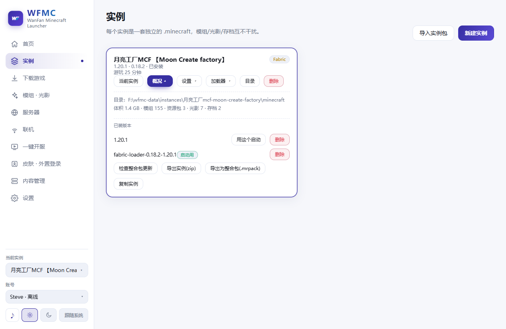
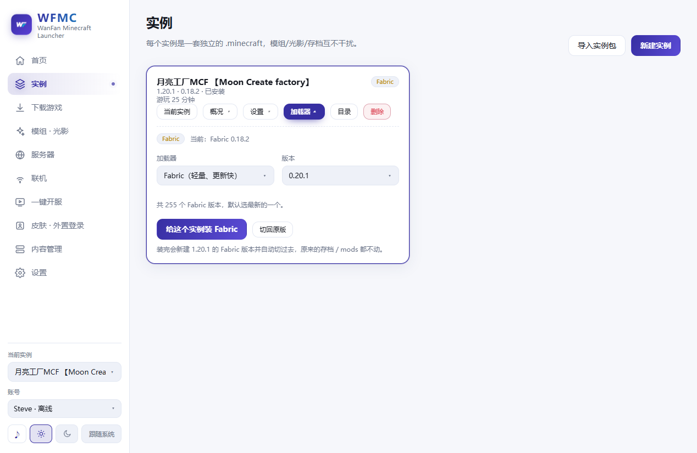

---

## 5. 装单个模组 / 光影 / 资源包

左边「模组 · 光影」。

1. **先确认装到哪**：顶部「安装到哪个实例」下拉，选对实例。右边会显示 `1.20.1 · fabric` 这类字样——**这就是你要的那个版本和加载器，不对就换实例。**
2. 切到要装的分栏：「模组」/「光影」/「资源包」。
3. 设「MC 版本」「加载器」，输关键词点「搜索」。
4. 点「安装最新版」，或「选版本」→ 那一行「装这个」。

**做对了会怎样**
- 点安装会先弹一个清单：必需前置一起装、可选前置你勾、冲突项只提示。
- 提示"开始安装"后，右下角任务面板跑进度；装完去「内容管理」→「模组」能看到新模组。
- 下次启动游戏就生效（前提：启动版本是带加载器的那个，见第 4 章）。

注意：
- **加载器和 MC 版本对不上的会被直接拦下来**，别硬装。
- 光影需要 `Iris`（Fabric 下）或 `OptiFine`，两者**不能同时装**。
- 装了没看到？「内容管理」→「模组」→点「刷新」；也可能你刚换过「安装到哪个实例」，看的是另一个实例的目录。

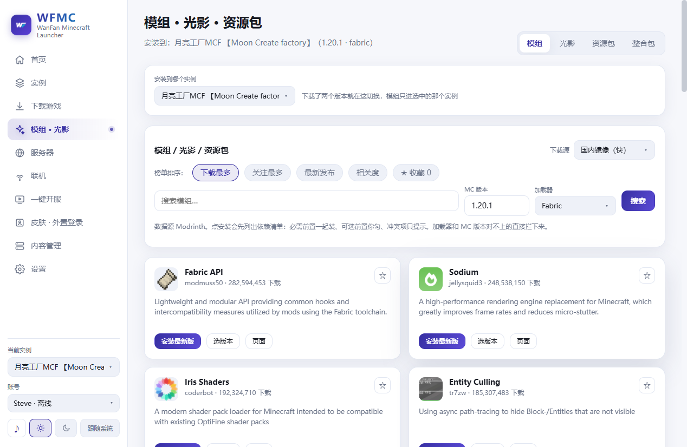

### 5.1 中文汉化

软件内置了社区汉化包（覆盖 900 多个模组）。装模组时可以一起装上；「内容管理」里有「看看翻了哪些模组」「卸载汉化包」。
- 仍然显示英文的，是汉化包里没收录的模组，只能等更新，或自己往资源包里放语言文件。
- 少数界面上的字（比如模组自己画的标题）是写死在程序里的，翻不了。

### 5.2 更新模组

「内容管理」→「**Mod 更新**」分栏：它会拿每个 jar 的特征值去 Modrinth 反查有没有新版，一键升级（旧文件会留成 `.old`）。
整个整合包想更新：「实例」→「概览」→「检查整合包更新」。

---

## 6. 进不去 / 装不上：对着这张表查

### 6.1 先让软件自己诊断（最省事）

「内容管理」→「**崩溃报告**」→ 点 **「一键诊断崩溃原因」**。

它内置 12 条判断规则（内存不够、Java 版本不对、缺类/类版本冲突、模组重复、模组依赖不满足、Mixin 注入失败、显卡驱动、网络、权限、版本文件损坏、游戏进程崩溃、EULA 未同意），会给出「原因 + 建议 + 证据」。

**做对了会怎样**：出现「诊断结果 · 文件名」和若干条问题描述。按建议做，再启动一次。
没有崩溃报告时它会写「没有崩溃报告，挺稳。」——那说明游戏根本没起来或没留文件，去看「运行日志」。

搞不定想找人帮忙：「崩溃报告」页 →「导出诊断包（日志+崩溃+ mod 清单）」，把这一个包发过去就够，不用一个个截图。

### 6.2 常见现象 → 处理

| 你看到的 | 多半是 | 怎么办 |
|---|---|---|
| 点了启动，窗口一闪就没 / 报 `UnsupportedClassVersionError`、`class file version` | Java 版本太低 | 见第 7 章，按版本装对应的 Java |
| `OutOfMemoryError`、进游戏一会儿就崩、卡成幻灯片 | 内存给小了 | 「实例」→「设置」→ 调大「最大内存」；1.20+ 带模组/光影一般 6–8 GB |
| `NoClassDefFoundError`、`NoSuchMethodError`、类版本冲突 | 加载器/模组版本不配套 | 用「一键诊断」，多半要换加载器版本或删掉那个模组 |
| 提示模组重复（Duplicate mods） | mods 里同一个模组有两个版本 | 「内容管理」→「模组」，删掉旧的那份 |
| 提示缺少前置/依赖不满足 | 缺前置模组 | 「模组 · 光影」装那个前置（点安装时清单里"必需前置"就是它） |
| `Mixin` 注入失败 | 两个模组打架 | 按诊断建议先停用其中一个 |
| 画面花屏、黑屏、崩溃指向显卡 | 显卡/驱动问题 | 更新显卡驱动；先关光影试 |
| 登录验证失败、连接超时 | 网络 | 设置 →「下载与网络」→ 填代理；开加速器也可以 |
| 提示权限不足 / 写入失败 | 装在受保护目录 | 把数据目录换到非系统盘（设置 →「数据目录」） |
| 提示版本文件损坏/缺失 | 游戏文件坏了 | 「首页」→「校验文件」，会自动补 |
| 装模组时提示要 API Key | CurseForge 需要 | 设置 →「CurseForge」填 Key（Modrinth 不需要） |
| 下载卡住不走 / 反复失败 | 镜像或网络 | 换「下载源」，检查磁盘空间，稍后重试（支持断点续传） |
| 服务器开不起来、提示 EULA | 首次开服要同意协议 | 在开服页确认 EULA 后重开 |

### 6.3 日志在哪

- 界面上：「首页」→「启动日志」（右上「展开」「导出」「清空」），是实时的。
- 文件里：`<数据目录>\instances\<实例名>\.minecraft\logs\latest.log`。设置页有「打开目录」。
- 更早的日志：「内容管理」→「运行日志」。

---

## 7. Java：唯一需要懂一点点的东西

游戏是用 Java 跑的，**版本对不上就是起不来**。规则（不用背，知道"新版要新 Java"就行）：

| Minecraft 版本 | 需要的 Java |
|---|---|
| 1.20.5 及以上 | Java 21 |
| 1.18 – 1.20.4 | Java 17 |
| 1.17 | Java 16 |
| 1.16 及更老 | Java 8 |

**正常情况你什么都不用做**：设置 →「Java 运行时」里选的是「自动选择（推荐）」，启动器会按版本自动挑；缺了会自己下 Mojang 的运行时。

要手动处理时：
1. 「重新扫描」——让它重新找机器上已有的 Java。
2. 没找到？点「下载 Java 21 运行时」/「下载 Java 17 运行时」/「下载 Java 8 运行时」。第一次约 150–200 MB，下过的不重复下。
3. 你自己装过 Java：点「手动指定 java.exe」选那个 exe。**注意挑对版本**——给 1.21 指 Java 17 一样起不来。

**做对了会怎样**：Java 列表里出现一条可用项（不是"未设置"）；启动后「启动日志」里会写「使用 Java: …（这个版本要 Java NN）」。

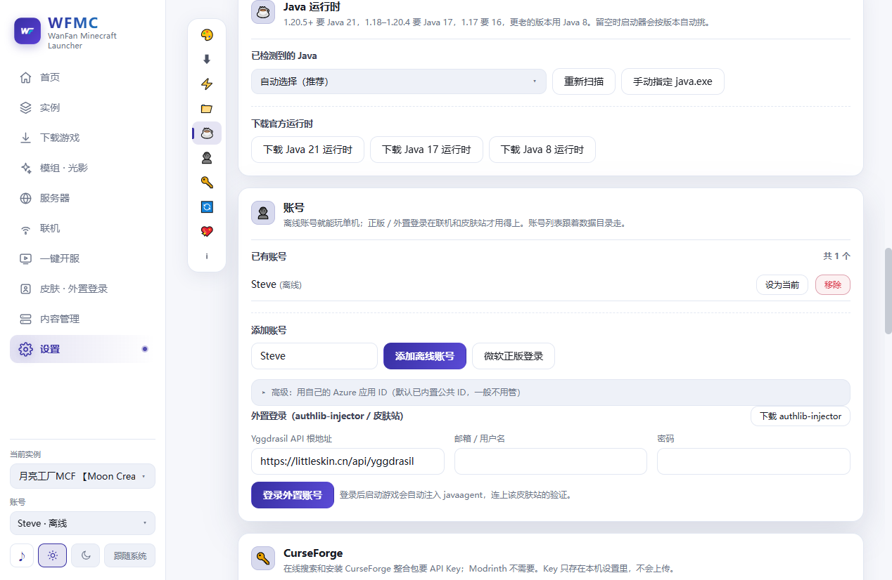

---

## 8. 和朋友联机：三条路，选一条

左边「联机」。页面里三张卡对应三种情况，**从上往下试**，先试最简单的。

### 8.1 局域网直连（在同一个路由器下）

1. 你在游戏里「对局域网开放」一个世界。
2. 页面点「开始发现局域网世界」。
3. 列表里出现房间 → 点进去。
   - 好友那边要授权一次；没出现就点「刷新列表」。

**做对了会怎样**：列表里出现 `某某 的世界` 和端口号。
> 「共享我的模组清单」可以只共享"版本/加载器/模组数"，不传 jar 文件；好友也用 WFMC 才看得到。

### 8.2 P2P 直连（不在同一个网）

1. 页面点「把 25565 端口映射到公网」——它会在路由器上加一条 TCP 映射（UPnP），把公网地址生成出来。
2. 如果游戏端口不是 25565：在「确认游戏监听端口」里改成实际端口，点「扫描端口」。
3. 复制生成出来的 `公网IP:端口` 发给好友，好友在游戏"添加服务器"里粘进去。

**做对了会怎样**：地址框里出现一条完整地址，好友能连上。流量不过第三方，延迟最低。
> 不确定自己公网 IP：点「查我的公网地址」。
> 家宽换端口后记得点「撤销映射」再重新映射。

### 8.3 公网中继（路由器不给映射 / 用了加速器）

点「一键公网中继」，它会给你一条「好友连接地址」，点「复制地址」发给好友即可。用完点「停掉中继」。
> 需要先「去开服」把服务端开起来——服务器离线时这里不会有地址。

**这三条都是临时的**：你退出游戏或关掉软件，房间就断了。想 7×24 常驻 → 第 9 章。

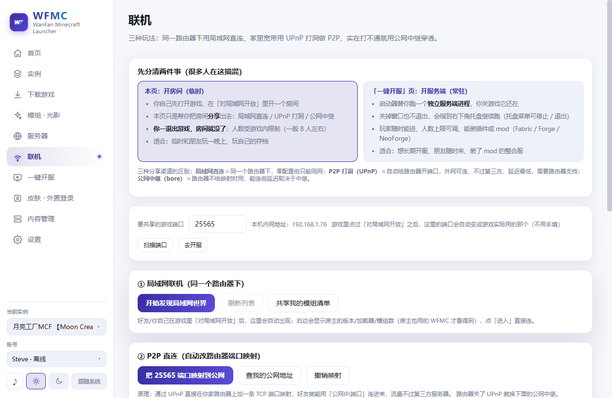

### 8.4 顺手：收藏常去的服务器

左边「服务器」：地址框填 `mc.hypixel.net` 这种（也支持 `play.example.com:25566`），点「收藏」；只想查一下不收藏就点「只查询」。
列表里能看到在线人数和延迟，点进去就直接带着 IP 进游戏。
> 「进服实例」在页头显示，开关这个实例的模组/版本跟着走——连别人的服务器时最好用**纯净实例**，模组不一致容易被踢。

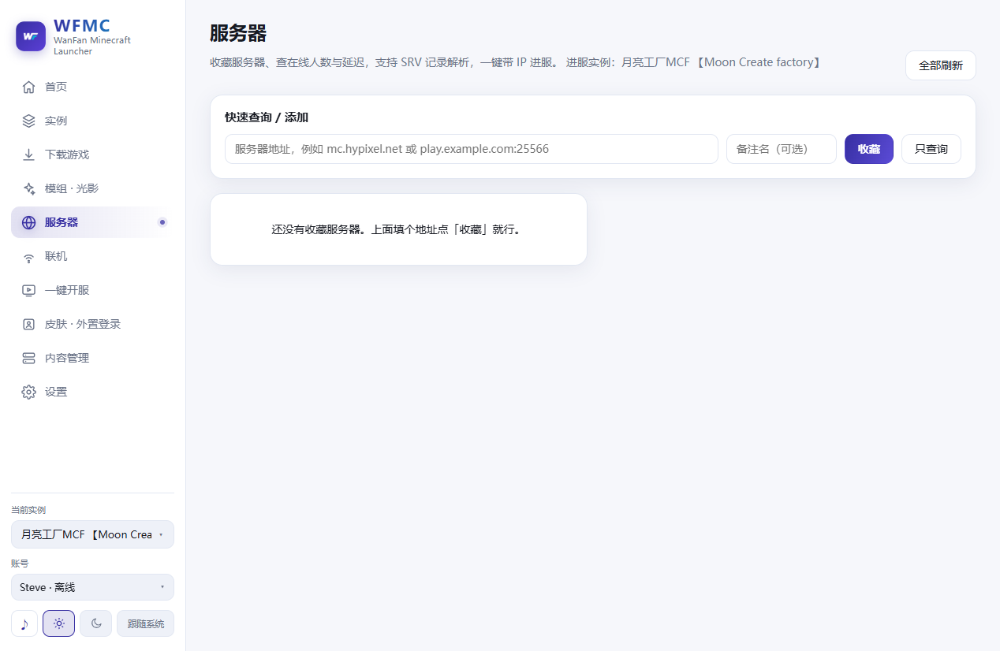

---

## 9. 开一个常驻服务器（一键开服）

左边「一键开服」。

1. 选「怎么建：」→「开个空白新服」，或「照现有实例开（带 mod）」（把现有实例的模组带过去）。
2. 「服务端类型」：`Paper（推荐，性能好、插件生态…）` 或 `Vanilla`。
3. 选「游戏版本」、「名称」、「内存 (MB)」（2048 起）、「端口」（默认 25565）。
4. 点「创建并下载」。
5. 首次启动确认 EULA（服务端协议）。

**做对了会怎样**：出现控制台和日志在滚；状态变成运行中；「联机」页能看到同步过来的端口，把地址发给好友就行。
- 控制台可以直接发命令：`list` 看在线、`op 名字` 给管理员、`stop` 关服。
- 「配置」里可以可视化改 `server.properties`（正版验证、难度、白名单等）。

> 它是个**独立进程**，关掉窗口会缩到托盘继续跑。想让它彻底退出：设置 →「关闭窗口时」→「直接退出程序」。

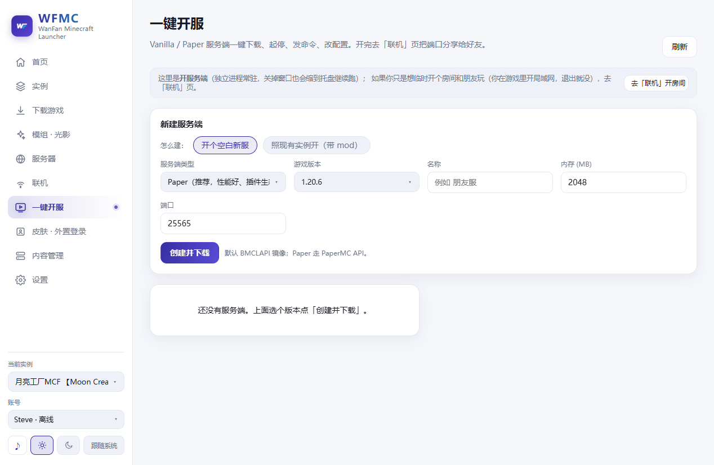

---

## 10. 账号与皮肤

三种账号，按需要选：

| 类型 | 怎么弄 | 能干什么 |
|---|---|---|
| **离线账号** | 设置 →「账号」→ 输昵称 → 点添加（侧边栏底部账号下拉也能就地加） | 单机、局域网玩；**进不了正版服务器** |
| **微软正版** | 设置 →「账号」→ 微软登录，按提示在浏览器输设备码 | 全部服务器 |
| **外置登录（LittleSkin 等）** | 「皮肤 · 外置登录」→ 填 Yggdrasil 根地址 + 邮箱/用户名 + 密码 →「登录」 | 皮肤站服务器；能显示自定义皮肤 |

外置登录要点：
- 地址一般是 `https://littleskin.cn/api/yggdrasil` 这种。
- 登录成功后软件会自动准备 `authlib-injector`（启动时把它注进游戏参数，让验证走你填的站点）。**没有它只能登录、进不去服务器**，所以别跳过。
- 也可以直接把 LittleSkin 的卡片拖进窗口，或复制它页面上那段字后点「从剪贴板识别」。
- 密码只发给你填的那个站点，本地不存明文。
- 切换当前账号：侧边栏底部的账号下拉。

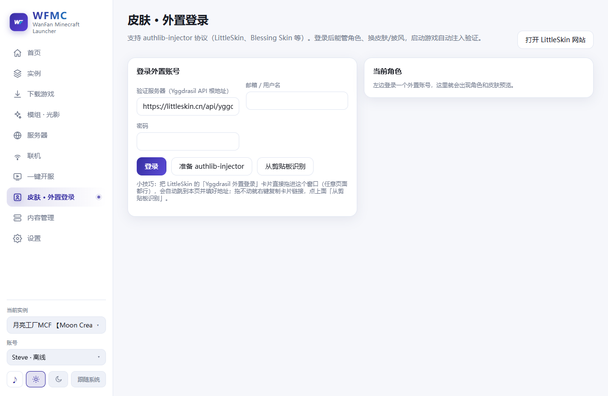

---

## 11. 数据在哪、怎么备份、怎么清理

### 11.1 目录结构

```
<数据目录>                                  ← 设置页顶部能看到，点「打开目录」直达
└─ instances\
   └─ <实例名>\
      └─ .minecraft\
         ├─ mods\        ← 模组
         ├─ saves\       ← 存档
         ├─ resourcepacks\  shaderpacks\
         ├─ config\      ← 模组配置
         └─ logs\        ← 日志
```

- 每个实例的游戏文件**共享** `libraries`/`assets`（不重复占空间），但 `mods`/存档/配置按版本隔离。
- 搬整个实例：「实例」→「概览」→「导出实例(zip)」；想给别人玩就「导出为整合包(.mrpack)」；想在本机复制一份就「复制实例」。

### 11.2 自动备份存档（建议开着）

设置 →「启动前自动备份存档」打开。每次启动前把 `saves` 打包成 zip，崩了能回滚。
> 备份失败不影响启动（日志里会写「存档备份失败（不影响启动）」）。

### 11.3 手动备份 / 恢复

「内容管理」→「**存档**」分栏：
- 「备份所有存档」——立刻打一个包。
- 「存档快照」——备份列表，能回滚到某个时间点。
- 「导入存档包」——装别人的存档；同名不会覆盖，新的会自动改名。
- 「校验存档包」——导入前检查包有没有坏。

### 11.4 清理空间

- 设置 →「清理与占用」：列出各项占了多大，每项都能单独「清理」。**只清缓存/下载/日志这类，游戏文件不动。**
- 设置 →「测速与清理」→「清理临时文件」：一键清临时文件。
- 想省空间：删掉不玩的实例（「实例」→「删除」，会连带删那个实例的游戏文件，想留就先把存档导出来）。

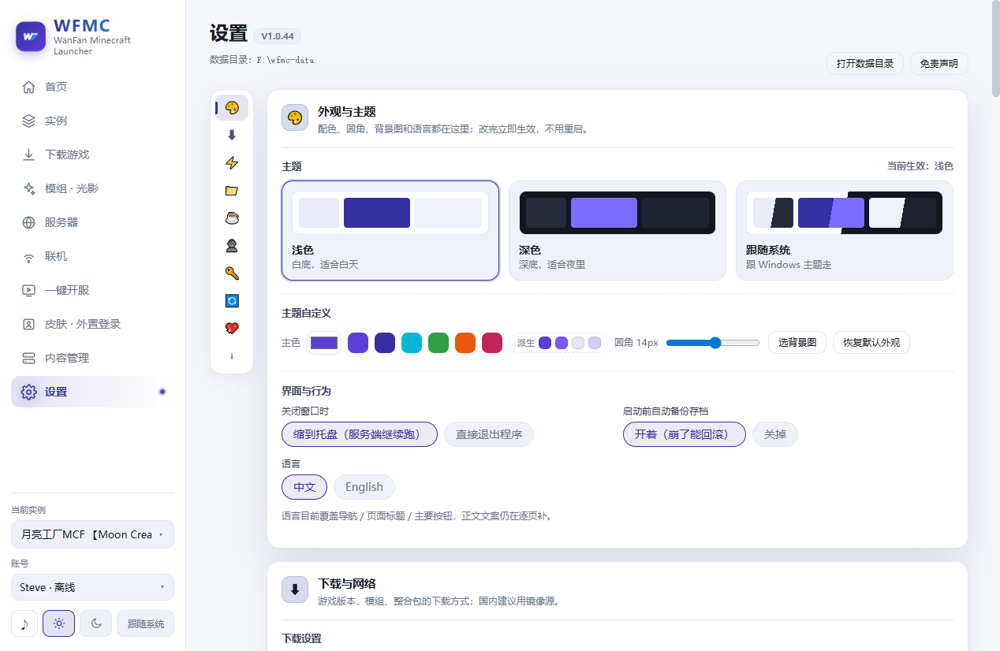
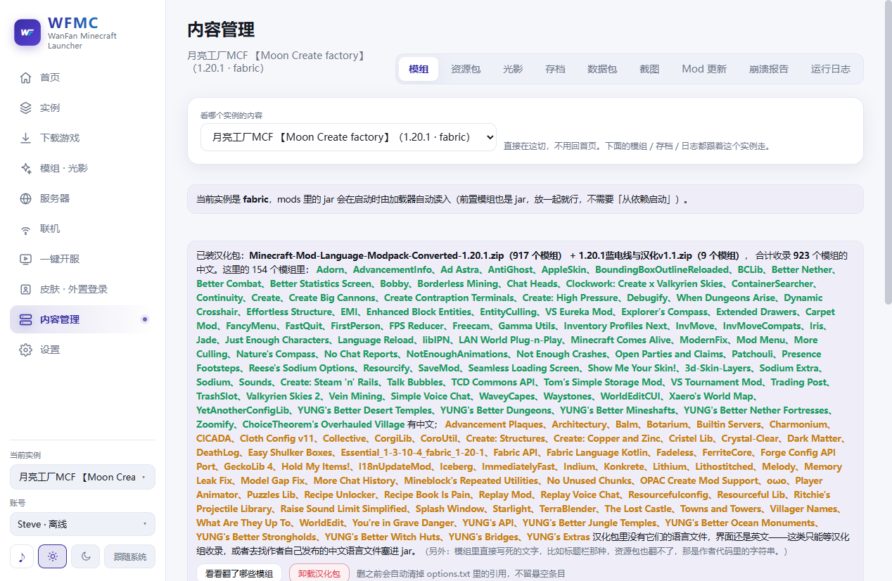
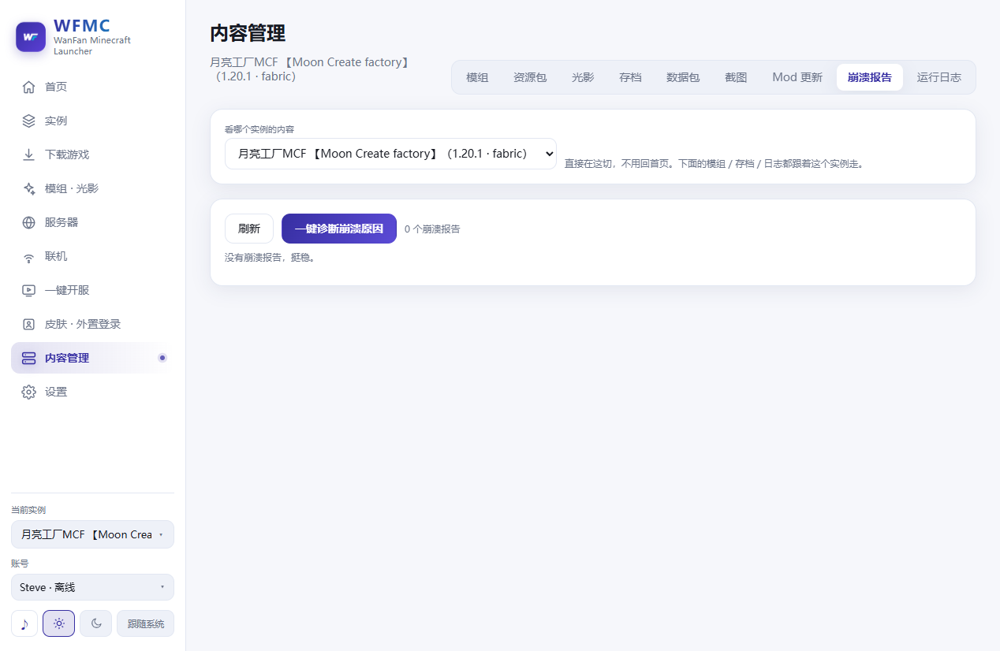

---

## 12. 界面速查

| 左边这一项 | 干什么 |
|---|---|
| **首页** | 选实例、点「启动游戏」，看启动日志；数据面板在这里 |
| **实例** | 每个实例的概览 / 设置 / 加载器 / 目录 / 删除；新建、导入、导出、复制、检查整合包更新 |
| **下载游戏** | 装原版或"原版+加载器"；贴链接下载任意文件 |
| **模组 · 光影** | 模组 / 光影 / 资源包 / 整合包 四个分栏，都在这装 |
| **服务器** | 收藏别人的服务器，查在线人数和延迟，一键带 IP 进服 |
| **联机** | 局域网 / P2P / 公网中继，临时开房间 |
| **一键开服** | 开常驻服务端（Paper/Vanilla），带控制台和配置 |
| **皮肤 · 外置登录** | 正版登录、LittleSkin 等外置登录、皮肤 |
| **内容管理** | 看这个实例里的模组/资源包/光影/存档/数据包/截图，升级模组，看崩溃报告和运行日志 |
| **设置** | 主题、下载源与代理、Java、账号、CurseForge Key、清理、卸载 |

侧边栏底部：**当前实例**下拉（快速切实例）、**账号**下拉、**主题**三键（浅色 / 深色 / 跟随系统）。
`Ctrl + K`：全局搜索（跳页面、搜功能）。

---

## 附录 A · 一句话词典

- **实例**：一套独立的游戏环境（一个 `.minecraft` 文件夹）。
- **版本**：一个具体的 Minecraft 版本条目，如 `1.20.1` 或 `fabric-loader-0.18.2-1.20.1`。
- **加载器**：Fabric / NeoForge / Forge / Quilt，让模组生效的底座。
- **前置**：某个模组依赖的另一个模组，不装它模组就崩。
- **资源包**：换贴图/音效/文字，不改玩法。
- **光影**：改光照和画面，吃显卡，需要 Iris 或 OptiFine。
- **镜像（BMCLAPI）**：国内加速的下载站，下游戏文件走它更快。
- **Java**：游戏运行环境，版本必须和 MC 版本匹配（见第 7 章）。
- **崩溃报告**：游戏崩溃时留下的说明书，「一键诊断崩溃原因」就是读它。
- **端口**：联机/开服用的"门牌号"，默认 `25565`。

## 附录 B · 三条保命原则

1. **先看「启动用」在哪一行**——模组不生效，九成是这个。
2. **装东西前先看「安装到哪个实例」**——装错地方等于没装。
3. **出事先点「一键诊断崩溃原因」，再「导出诊断包」**——比描述半天有用。

---

> 截图重拍方法（维护者用）：项目根目录执行 `.\shot.ps1 .tmp-shot\guide-XX.png <页面名>`，然后复制到 `docs/images/`。脚本会先关掉正在运行的软件，别在玩游戏时跑。
